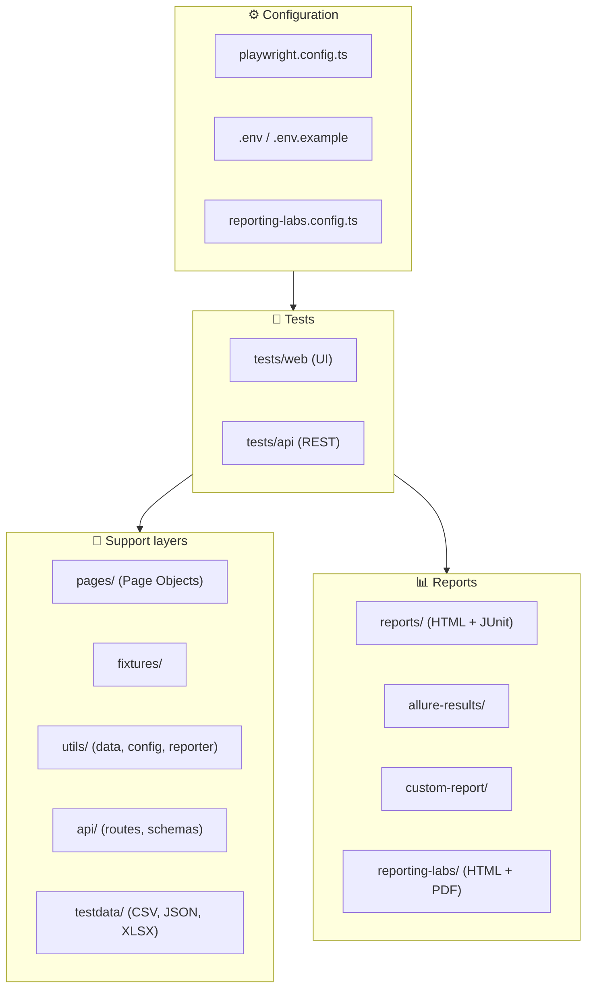
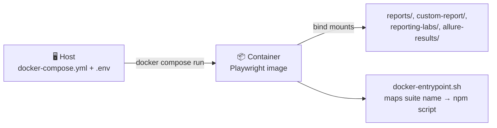
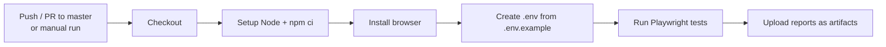
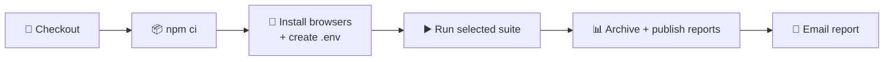

# 🎭 Playwright + TypeScript Automation Framework
 
> **A multi-layer test automation framework** for **Web UI** and **REST API** testing of an e-commerce application, built with Playwright, TypeScript and the Page Object Model, and wired into **GitHub Actions**, **Docker** and **Jenkins** with rich reporting.
 
[](https://playwright.dev)
[](https://www.typescriptlang.org/)
[](https://github.com/features/actions)
[](https://www.docker.com/)
[](https://www.jenkins.io/)
[](https://allurereport.com/)
[](https://nodejs.org/)
 
---
 
## 📖 Table of Contents
 
- [Overview](#-overview)
- [Key Features](#-key-features)
- [Framework Architecture](#-framework-architecture)
- [Project Structure](#-project-structure)
- [Tech Stack](#-tech-stack)
- [Prerequisites](#-prerequisites)
- [Quick Start](#-quick-start)
- [Environment Configuration](#-environment-configuration)
- [Test Suites & Tags](#-test-suites--tags)
- [Running Tests](#-running-tests)
- [Page Object Model](#-page-object-model)
- [API Testing](#-api-testing)
- [Data-Driven Testing](#-data-driven-testing)
- [Reporting](#-reporting)
- [Docker Setup](#-docker-setup)
- [CI/CD with GitHub Actions](#-cicd-with-github-actions)
- [CI/CD with Jenkins](#-cicd-with-jenkins)
- [Troubleshooting](#-troubleshooting)
- [Coding Guidelines](#-coding-guidelines)
- [Acknowledgements](#-acknowledgements)
- [Author](#-author)
---
 
## 🎯 Overview
 
This framework provides a **unified, scalable automation solution** that tests an OpenCart web store and the FakeStoreAPI across two layers:
 
| Layer           | Technology                                  | What We Test                                                                        |
| --------------- | ------------------------------------------- | ----------------------------------------------------------------------------------- |
| 🌐 **Web UI**   | Playwright + Page Object Model              | Customer registration, login / logout, product search, cart, end-to-end shopping flow |
| 🔌 **REST API** | Playwright `request` fixture + FakeStoreAPI | Authentication, carts, products, users, response structure                          |
 
The `@master` suite contains **43 tests** (7 Web UI + 36 API). The framework runs locally, in Docker, on GitHub Actions and on Jenkins, and produces several report formats on every run.
 
---
 
## ✨ Key Features
 
- ✅ **Page Object Model (POM)** with custom fixtures for clean, type-safe test code
- ✅ **Web UI + REST API** testing in a single framework
- ✅ **Tag-based suites** — `@master`, `@sanity`, `@regression`, `@web`, `@api`, `@end-to-end`, `@datadriven`
- ✅ **Data-driven testing** from CSV, JSON and Excel files
- ✅ **Random test data** generation with Faker.js
- ✅ **Five report types** — Playwright HTML, JUnit XML, Allure, a custom HTML dashboard and **reporting-labs**
- ✅ **Docker support** — same results on every machine
- ✅ **GitHub Actions workflow** with suite, browser, mode and runner selection
- ✅ **Jenkins pipeline** that publishes reports and **emails them as attachments**
- ✅ **Retries and artifacts** — screenshots, videos and traces on failure
---
 
## 🏗️ Framework Architecture
 

 
---
 
## 📁 Project Structure
 
```text
Playwright_OpencartStore_AI_V1.0/
├── .github/workflows/
│   └── playwright.yml          # GitHub Actions workflow
├── api/                        # API routes and JSON schemas
├── docs/                       # Extra documentation
├── fixtures/                   # Custom Playwright fixtures
├── pages/                      # Page Object classes
├── prompts/                    # AI prompt templates
├── testdata/                   # CSV / JSON / Excel test data
├── tests/
│   ├── api/                    # REST API specs
│   └── web/                    # Web UI specs
├── utils/                      # Data generator, API config, custom reporter
├── reporting-labs/             # reporting-labs output (HTML, JSON, PDF)
├── reports/                    # Playwright HTML + JUnit output
├── custom-report/              # Custom HTML dashboard output
├── allure-results/             # Allure raw results
├── Dockerfile
├── docker-compose.yml
├── docker-entrypoint.sh        # Maps suite names to npm scripts
├── Jenkinsfile.windows         # Jenkins declarative pipeline
├── playwright.config.ts
├── reporting-labs.config.ts
├── reporting-labs.history.json # Run history used for trends
├── .env.example
├── env_setup.bat
├── package.json
└── tsconfig.json
```
 
### 📂 Folder Breakdown
 
| Path              | Purpose                                                              |
| ----------------- | -------------------------------------------------------------------- |
| `pages/`          | Page Object classes — locators and actions for each page             |
| `fixtures/`       | Custom fixtures that inject page objects into tests                  |
| `tests/web/`      | Web UI specs (registration, data-driven login, end-to-end flow)      |
| `tests/api/`      | REST API specs (authentication, carts and more) against FakeStoreAPI |
| `api/`            | Centralised endpoint routes and JSON schemas                         |
| `utils/`          | Random data generator, API config helper, custom HTML reporter       |
| `testdata/`       | External data files for data-driven tests                            |
| `reporting-labs/` | Generated reporting-labs report (`index.html`, `report.json`, `report.pdf`) |
| `reports/`        | Playwright HTML report and `results.xml` (JUnit)                     |
| `custom-report/`  | Generated custom HTML dashboard                                      |
 
---
 
## 🛠️ Tech Stack
 
| Technology                                                           | Purpose                          |
| -------------------------------------------------------------------- | -------------------------------- |
| [Playwright](https://playwright.dev/)                                | Browser automation and API tests |
| [TypeScript](https://www.typescriptlang.org/)                        | Type-safe test code              |
| [Node.js](https://nodejs.org/) 20+                                   | Runtime                          |
| [Faker.js](https://fakerjs.dev/)                                     | Random test data                 |
| [dotenv](https://www.npmjs.com/package/dotenv)                       | Environment variable management  |
| [csv-parse](https://www.npmjs.com/package/csv-parse), [xlsx](https://www.npmjs.com/package/xlsx) | CSV and Excel data reading |
| [Allure Playwright](https://www.npmjs.com/package/allure-playwright) | Allure reporting                 |
| [reporting-labs](https://www.npmjs.com/package/reporting-labs)       | Single-file HTML + PDF reports   |
| [Docker](https://www.docker.com/)                                    | Containerised execution          |
| [GitHub Actions](https://github.com/features/actions)                | Cloud CI                         |
| [Jenkins](https://www.jenkins.io/)                                   | Local / on-prem CI with email    |
 
---
 
## 📋 Prerequisites
 
- **Node.js** v20 or later → [Download](https://nodejs.org/)
- **npm** v9+ (comes with Node.js)
- **Git** → [Download](https://git-scm.com/)
- **Docker Desktop** (optional, for containerised runs)
- **Java 21** (only if you run Jenkins or Allure locally) → [Download](https://adoptium.net/)
---
 
## 🚀 Quick Start
 
```bash
# 1. Clone
git clone https://github.com/Madhukar19996/Playwright_OpencartStore_AI_V1.0.git
cd Playwright_OpencartStore_AI_V1.0
 
# 2. Install dependencies
npm install
 
# 3. Install Playwright browsers
npx playwright install
 
# 4. Create your .env file
cp .env.example .env        # Windows PowerShell: Copy-Item .env.example .env
 
# 5. Run the master suite
npm run test:master
```
 
---
 
## 🔧 Environment Configuration
 
Secrets and URLs live in a `.env` file (never commit it — it is in `.gitignore`). Start from `.env.example`:
 
```env
# Environment label shown in reports
APP_ENV=qa
 
# --- API (FakeStoreAPI) ---
API_BASE_URL=https://fakestoreapi.com
FAKESTORE_USERNAME=your-api-username
FAKESTORE_PASSWORD=your-api-password
USER_ID=1
PRODUCT_ID=1
CART_ID=1
LIMIT=3
START_DATE=2019-12-10
END_DATE=2020-10-10
 
# --- Web application ---
# Add the web URL and test account keys exactly as listed in .env.example
```
 
> 💡 The API tests read their values with a helper that **fails fast** if a variable is missing, for example `Required API environment variable FAKESTORE_USERNAME is not set`. Always keep `.env.example` in sync with the variables your tests use.
 
---
 
## 🏷️ Test Suites & Tags
 
Tests are grouped with tags in the test title. Each tag has an npm script:
 
| Tag             | npm Script                | Description                                |
| --------------- | ------------------------- | ------------------------------------------ |
| `@master`       | `npm run test:master`     | **Master suite** — all critical tests      |
| `@sanity`       | `npm run test:sanity`     | Quick smoke tests                          |
| `@regression`   | `npm run test:regression` | Full regression coverage                   |
| `@web`          | `npm run test:web`        | Web UI tests only                          |
| `@api`          | `npm run test:api`        | API tests only                             |
| `@end-to-end`   | `npm run test:e2e`        | End-to-end scenarios                       |
| `@datadriven`   | `npm run test:datadriven` | Data-driven tests                          |
 
A test can carry several tags:
 
```typescript
test('GET - All carts @master @sanity @api', async ({ request }) => { /* ... */ });
test('Valid login (row 1) @master @datadriven @web', async ({ page }) => { /* ... */ });
```
 
> ℹ️ `test:e2e` uses the **`@end-to-end`** tag (not `@e2e`). `playwright.config.ts` also sets a default `grep` of `@master`, so a plain `npx playwright test` runs the master suite.
 
---
 
## ▶️ Running Tests
 
```bash
npm run test:master            # Master suite
npm run test:sanity            # Sanity
npm run test:regression        # Regression
npm run test:web               # Web UI only
npm run test:api               # API only
npm run test:e2e               # End-to-end
npm run test:datadriven        # Data-driven
 
npm run test:master:headed     # Headed browser
npm run test:sanity:debug      # Playwright Inspector
```
 
More options:
 
```bash
npx playwright test tests/web/user-registration.spec.ts   # single file
npx playwright test --grep "@api|@web"                    # multiple tags
npx playwright test --project=chromium                    # one browser
npx playwright test --grep "@sanity" --headed             # headed run
```
 
### Config highlights (`playwright.config.ts`)
 
| Setting       | Value                                                   |
| ------------- | ------------------------------------------------------- |
| Timeout       | 30 seconds per test                                     |
| Parallelism   | Fully parallel locally                                  |
| Retries / workers in CI (`CI` set) | 2 retries, 1 worker                    |
| Failure artifacts | Screenshot on failure, video retained on failure, trace on first retry |
 
> ⚠️ With 2 retries in CI, each failing test is attempted **3 times**. A summary of "111 failed" for a 43-test suite simply means 37 tests failed × 3 attempts.
 
---
 
## 📄 Page Object Model
 
Every page has a **Page Object class** with its locators and actions. Tests never touch locators directly.
 
```typescript
// pages/LoginPage.ts  (example)
export class LoginPage {
  private readonly emailInput: Locator;
  private readonly passwordInput: Locator;
  private readonly loginButton: Locator;
 
  constructor(page: Page) {
    this.emailInput = page.locator('#input-email');
    this.passwordInput = page.locator('#input-password');
    this.loginButton = page.getByRole('button', { name: 'Login' });
  }
 
  async login(email: string, password: string): Promise<void> {
    await this.emailInput.fill(email);
    await this.passwordInput.fill(password);
    await this.loginButton.click();
  }
}
```
 
Page objects are injected into tests with custom fixtures:
 
```typescript
// fixtures/pageFixtures.ts  (example)
export const test = base.extend<{ loginPage: LoginPage }>({
  loginPage: async ({ page }, use) => {
    await use(new LoginPage(page));
  },
});
export { expect } from '@playwright/test';
```
 
```typescript
// tests/web/... (example)
import { test, expect } from '../../fixtures/pageFixtures';
 
test('Valid login @master @web', async ({ loginPage }) => {
  await test.step('Submit valid credentials', async () => {
    await loginPage.login(email, password);
  });
});
```
 
---
 
## 🌐 API Testing
 
API tests run against [FakeStoreAPI](https://fakestoreapi.com/) using Playwright's `request` fixture. Routes are centralised in `api/endpoints/routes.ts`, and the base URL and required variables come from `utils/apiTestConfig.ts`.
 
```typescript
// tests/api/carts-api.spec.ts  (simplified)
test('GET - All carts @master @sanity @api', async ({ request }) => {
  const response = await request.get(`${API_BASE_URL}${Routes.GET_ALL_CARTS}`);
 
  expect(response.status(), 'Cart list request should return HTTP 200.').toBe(200);
  const carts = (await response.json()) as Cart[];
  expect(Array.isArray(carts), 'Cart response should be an array.').toBeTruthy();
});
```
 
Covered so far: authentication (valid and invalid login), carts (all, by ID, by date range, by user) and more. See `tests/api/` for the full list.
 
---
 
## 📊 Data-Driven Testing
 
Login scenarios are driven by external files in `testdata/`:
 
| Format    | File                                |
| --------- | ----------------------------------- |
| **CSV**   | `testdata/opencart_logindata.csv`   |
| **JSON**  | `testdata/opencart_logindata.json`  |
| **Excel** | `testdata/opencart_logindata.xlsx`  |
 
Each row becomes its own test (for example `Valid login (row 1)`, `Invalid login (row 2)`). API payloads are kept in `testdata/fakestore_api_payloads.json`.
 
Random data (names, emails, passwords) comes from `RandomDataUtil` in `utils/dataGenerator.ts`.
 
---
 
## 📈 Reporting
 
Every run can produce these reports:
 
| Report                | Location                                             | Notes                              |
| --------------------- | ---------------------------------------------------- | ---------------------------------- |
| Playwright HTML       | `reports/index.html`                                 | Built-in report with traces        |
| JUnit XML             | `reports/results.xml`                                | Used by Jenkins test trends        |
| Allure                | `allure-results/` → `allure-report/`                 | Needs Java and the Allure CLI      |
| Custom HTML dashboard | `custom-report/report_<timestamp>.html`              | Generated by `utils/CustomReporter.ts` |
| **reporting-labs**    | `reporting-labs/index.html`, `report.json`, `report.pdf` | Single-file HTML + PDF report |
 
### reporting-labs
 
[reporting-labs](https://www.npmjs.com/package/reporting-labs) is an open source Playwright reporting tool by **Naveen Khunteta**. It gives a single HTML file that needs no server, login or database, so it is easy to share on Slack, attach to a Jira ticket or send by email.
 
```bash
npm i -D reporting-labs
```
 
Add it to the `reporter` list in `playwright.config.ts`:
 
```typescript
import reportingLabs from './reporting-labs.config';
 
reporter: [
  ['list'],
  ['reporting-labs', reportingLabs],
  // ...other reporters
],
```
 
Optional: add metadata to each test so the report can show priority, owner and feature:
 
```typescript
/** @priority P1 @owner Madhukar @feature login */
test('Valid login @master @web', async ({ loginPage }) => { /* ... */ });
```
 
Set `warnMissingMeta: false` in `reporting-labs.config.ts` to hide the "no meta()" warning. Keep `reporting-labs.history.json` between runs so the report can show history and trends.
 
### Open the Allure report
 
```bash
npx allure generate allure-results --clean -o allure-report
npx allure open allure-report
```
 
### Screenshots
 
Add your screenshots to an `images/` folder and reference them here:
 
<!--


-->
 
---
 
## 🐳 Docker Setup
 
Run the tests in a consistent container with no local browser setup.
 

 
### Important: keep versions in sync
 
The Docker image tag **must match** the `@playwright/test` version in `package.json`. Otherwise browser tests fail with `Executable doesn't exist ... please run playwright install`.
 
```dockerfile
# Dockerfile
FROM mcr.microsoft.com/playwright:v1.64.1-noble
```
 
Pin the package without `^` so the two never drift apart:
 
```json
"@playwright/test": "1.64.1"
```
 
### Build and run
 
```bash
docker compose build
 
docker compose run --rm playwright-tests            # default suite (all)
docker compose run --rm playwright-tests master
docker compose run --rm playwright-tests sanity
docker compose run --rm playwright-tests regression
docker compose run --rm playwright-tests web
docker compose run --rm playwright-tests api
docker compose run --rm playwright-tests e2e
docker compose run --rm playwright-tests datadriven
```
 
Check which Playwright version is inside the image (the entrypoint treats extra words as suite names, so override it):
 
```bash
docker run --rm --entrypoint npx <image-name> playwright --version
```
 
### Notes
 
- `.env` is **not baked into the image**. It is passed with `env_file` / a bind mount, so secrets never end up in the image.
- Reports are written to bind-mounted folders, so they appear on your host machine.
- After changing `package.json` or the Playwright version, run `docker compose build` again.
- Inside the container API tests use your machine's network, so they are not blocked the way they are on GitHub-hosted runners.
---
 
## 🚀 CI/CD with GitHub Actions
 
The workflow is in `.github/workflows/playwright.yml`.
 

 
### Triggers and inputs
 
| Trigger                | Behaviour                                                       |
| ---------------------- | --------------------------------------------------------------- |
| `push` / `pull_request` on `master` | Runs on a **GitHub-hosted** Windows runner           |
| Manual (`workflow_dispatch`)        | Choose the options below                              |
 
| Input        | Choices                                                                              |
| ------------ | ------------------------------------------------------------------------------------ |
| `test_suite` | `test:master`, `test:sanity`, `test:regression`, `test:e2e`, `test:api`, `test:web`, `test:datadriven` |
| `browser`    | `chromium`, `firefox`, `webkit`                                                      |
| `mode`       | `headless`, `headed`                                                                 |
| `runner`     | `github-hosted` (default) or `self-hosted`                                           |
 
To run it manually: **Repo → Actions → Playwright Tests → Run workflow**.
 
### Artifacts
 
Each run uploads `playwright-report`, `custom-report`, `allure-results`, `reporting-labs-report` and `test-results` (traces and videos).
 
### ⚠️ API tests and Cloudflare
 
`fakestoreapi.com` sits behind Cloudflare, which returns **HTTP 403 ("Just a moment...")** to GitHub-hosted runner IPs. Changing headers or the User-Agent does not help. Because of this:
 
- On **GitHub-hosted** runners the workflow **skips `@api` tests** (so web tests and reports stay green).
- To run API tests in CI, start a manual run with **`runner = self-hosted`**. This needs a self-hosted runner on a machine with normal internet access:
  1. **Repo → Settings → Actions → Runners → New self-hosted runner → Windows**
  2. Follow the download and `config.cmd` steps shown there (keep the default labels `self-hosted, Windows, X64`)
  3. Start it with `./run.cmd` and wait for the status **Idle**
> If a job shows "Waiting for a runner to pick up this job", the self-hosted runner is offline.
 
---
 
## 🔁 CI/CD with Jenkins
 
The declarative pipeline is in `Jenkinsfile.windows` (Windows agent).
 

 
### Pipeline parameters
 
| Parameter    | Choices                                                                              |
| ------------ | ------------------------------------------------------------------------------------ |
| `TEST_SUITE` | `test:e2e`, `test:master`, `test:sanity`, `test:regression`, `test:api`, `test:web`, `test:datadriven` |
| `BROWSER`    | `chromium`, `firefox`, `webkit`                                                      |
| `MODE`       | `headless`, `headed`                                                                 |
 
### Post-build actions
 
- Archives `reports/`, `custom-report/`, `allure-results/` and `reporting-labs/`
- Publishes JUnit results and the Allure report
- Publishes three HTML reports: **Playwright HTML Report**, **Custom Test Report** and **Reporting Labs Report**
- Sends an **email with the build status** and attaches `reporting-labs/index.html` and `reporting-labs/report.pdf`
- Cleans up `allure-results` on success
### Jenkins requirements
 
| Requirement          | Details                                                                                  |
| -------------------- | ---------------------------------------------------------------------------------------- |
| Java                 | Current Jenkins releases need **Java 21 or 25**. Java 23 is not supported.               |
| Plugins              | Git, Pipeline, PowerShell, JUnit, Allure, HTML Publisher, **Email Extension**            |
| Tools                | A Git tool named `MyGIT` (see the `tools` block in the Jenkinsfile)                      |
 
Start Jenkins with Java 21 (example for a WAR install on Windows):
 
```powershell
& "C:\Program Files\Eclipse Adoptium\jdk-21.x.x-hotspot\bin\java.exe" -jar D:\Automation\jenkins.war --httpPort=8080
```
 
### Email setup (Gmail SMTP)
 
1. In the Google account used to **send** mail, enable **2-Step Verification** and create an **App Password** (a normal password will not work).
2. In Jenkins: **Manage Jenkins → System → Extended E-mail Notification**
   - SMTP server: `smtp.gmail.com`, port `465`
   - Advanced → Credentials: *Username with password* (Gmail address + App Password)
   - Tick **Use SSL**
3. Set **Jenkins Location → System Admin e-mail address** to the same sender address.
4. In `Jenkinsfile.windows`, set `to:` and `from:` in the `emailext` block. **The `from` address must be the same account used for the SMTP login.**
> 🔒 Never put the App Password in the Jenkinsfile or in Git. Keep it only in Jenkins credentials.
 
> ℹ️ Links inside the email point to `localhost:8080` and open only on the machine running Jenkins. That is why the reports are **attached** to the email.
 
### Viewing HTML reports inside Jenkins
 
Jenkins blocks JavaScript in published HTML reports (Content Security Policy), so a report may look blank. Either download the report from the build's artifacts and open it locally, or start Jenkins with the CSP relaxed (only on a private, local Jenkins):
 
```powershell
java "-Dhudson.model.DirectoryBrowserSupport.CSP=" -jar jenkins.war --httpPort=8080
```
 
---
 
## 🩺 Troubleshooting
 
| Problem | Cause | Fix |
| ------- | ----- | --- |
| API tests return **403** in GitHub Actions, body shows "Just a moment..." | Cloudflare blocks GitHub-hosted runner IPs | Run API tests locally, in Docker, or with `runner = self-hosted` |
| `Executable doesn't exist ... chromium_headless_shell` in Docker | Docker image version ≠ installed Playwright version | Use the same version in `Dockerfile` and `package.json`, then `docker compose build` |
| `Required API environment variable ... is not set` | `.env` is missing inside the container / CI | Provide `.env` through `env_file`, a bind mount or the workflow's `.env` step |
| `No tests found` for the e2e suite | Tag mismatch (`@e2e` vs `@end-to-end`) | Use `npm run test:e2e` or `--grep "@end-to-end"` |
| Summary shows 111 failed but only 43 tests exist | Retries (1 run + 2 retries per failing test) | Fix the failing tests, or set `retries: 0` while debugging |
| GitHub Actions step is green but no tests ran | In PowerShell `$args` is a reserved variable | Use another variable name and check `$LASTEXITCODE` |
| Jenkins error `Running with Java 23 ... not supported` | Unsupported Java version | Start Jenkins with Java 21 |
| Jenkins upgrade fails: file is being used by another process | Running WAR file cannot be replaced on Windows | Stop Jenkins, replace `jenkins.war`, start again |
| Jenkins email not received | SMTP username typo, wrong App Password, or sender ≠ login account | Use the **Test configuration** button in *E-mail Notification*, check the Jenkins system log and the sender's *Sent* folder |
| "Waiting for a runner to pick up this job" | Self-hosted runner is offline | Start the runner (`./run.cmd`) or choose `github-hosted` |
 
---
 
## 📋 Coding Guidelines
 
- Use the **Page Object Model** for all UI interactions
- Tag every test (`@master`, `@api`, `@web`, ...)
- Write descriptive test names and use `test.step()` for multi-step scenarios
- Keep **locators in page objects**, never in test files
- Use **fixtures** instead of creating page objects manually
- Never commit `.env` or secrets; keep `.env.example` up to date
- Run `npm run test:master` locally before pushing
---
 
## 🙏 Acknowledgements
 
- **Pavan Kumar** — I learned Playwright with TypeScript (Web & API testing) from his Udemy course *"Learn Playwright with TypeScript (Web & API Testing)"*. The fundamentals from his course are the base of this framework. Thank you, Sir! 🎓
- **Naveen Khunteta** (Founder, Naveen Automation Labs) — for [reporting-labs](https://www.npmjs.com/package/reporting-labs), the open source reporting tool that makes the reports in this project clean and easy to share, including in CI. Thank you! 📊
---
 
## 👨‍💻 Author
 
**Madhukar Pandey** — QA Automation Engineer
 
| | |
| --- | --- |
| 🐙 **GitHub** | [Madhukar19996](https://github.com/Madhukar19996) |
| 💼 **LinkedIn** | https://www.linkedin.com/in/madhukar-pandey-940aa01ba/?isSelfProfile=true |
 
---
 
## 📄 License
 
Add your preferred license (for example MIT or ISC) in a `LICENSE` file and update this section.
 